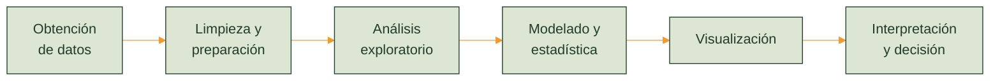

<!-- Paleta: verde bosque #1F3D2B / #2F5D3F | naranja #F59A2B | salvia #DDE5D3 | crema #F7F6F1 | turquesa #2E8B8B -->

  

<h1 align="center">Convierte datos en decisiones.</h1>

  Estudiante de Ingeniería en Sistemas Computacionales especializado en Ciencia de Datos. 
  Limpio, analizo y visualizo información para apoyar decisiones con evidencia.

  
  

<table width="100%">
<tr>
<td width="25%" valign="top" align="center">
 
Exploración y estadística descriptiva para entender los datos antes de concluir.
</td>
<td width="25%" valign="top" align="center">
 
Preparación y validación para que el análisis sea confiable.
</td>
<td width="25%" valign="top" align="center">
 
Dashboards y gráficas que comunican resultados con claridad.
</td>
<td width="25%" valign="top" align="center">
 
Interpretación orientada a la acción y a los objetivos del negocio.
</td>
</tr>
</table>

<table width="100%">
<tr>
<td width="33%" valign="top">
 
Archivos, bases de datos y fuentes externas con Python y SQL.
</td>
<td width="33%" valign="top">
 
Nulos, duplicados, tipos de dato y valores atípicos.
</td>
<td width="33%" valign="top">
 
Estadística descriptiva, correlaciones y detección de patrones.
</td>
</tr>
<tr>
<td valign="top">
 
SQL sobre PostgreSQL, MySQL y BigQuery.
</td>
<td valign="top">
 
Indicadores (KPI) y reportes interactivos en Power BI.
</td>
<td valign="top">
 
Tablas dinámicas y fórmulas avanzadas en Excel.
</td>
</tr>
</table>

<table width="100%">
<tr>
<td width="22%" align="center"></td>
<td>
  
  
  
  
  
</td>
</tr>
<tr>
<td align="center"></td>
<td></td>
</tr>
<tr>
<td align="center"></td>
<td></td>
</tr>
<tr>
<td align="center"></td>
<td></td>
</tr>
<tr>
<td align="center"></td>
<td></td>
</tr>
</table>

<table width="100%">
<tr>
<td colspan="2" valign="top">

**Análisis y visualización de datos**

Proyectos y prácticas que recorren el ciclo analítico completo: obtención, limpieza, exploración, visualización e interpretación de resultados.

&nbsp;

</td>
</tr>
<tr>
<td width="50%" valign="top">

**Sistema CRM para estudiantes**

Gestión de la relación entre vendedores y clientes con seguimiento de ventas y analítica integrada: usuarios y roles, historial de interacciones, etapas de venta, recomendación de productos y reportes.

&nbsp;

</td>
<td width="50%" valign="top">

**Sistema de seguimiento de proyectos**

Aplicación empresarial para administrar el ciclo de vida de proyectos: autenticación, roles de administrador y operador, registro de proyectos y posibles proyectos, seguimiento de actividades, estados y avances.

&nbsp;

</td>
</tr>
</table>

<table width="100%">
<tr>
<td width="40%" align="center"></td>
<td width="35%" align="center"></td>
<td width="25%" align="center"></td>
</tr>
<tr>
<td align="center"><b>Ingeniería en Sistemas Computacionales</b></td>
<td align="center">[Completar institución]</td>
<td align="center">[Año] - Actual</td>
</tr>
</table>

  
  

  

  

  
  
  

