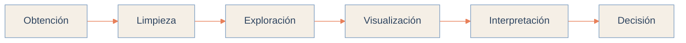

<!-- Paleta: beige #F5EFE6 / #E3D6C4 | azul polvo #7C9CBF / #C9D6E4 | azul profundo #2F4560 | acento coral #E8805A -->


<p align="center">
  
</p>

<p align="center">
  
  
  
</p>

<p align="center">
  <a href="mailto:islasdaniel752@gmail.com"></a>
  <a href="https://www.linkedin.com/in/TU-USUARIO"></a>
  <a href="https://github.com/Dnislas"></a>
</p>


<br/>

<h3 align="center">P E R F I L</h3>

<table width="100%">
<tr>
<td width="60%" valign="top">

Estudiante de **Ingeniería en Sistemas Computacionales** especializado en **Ciencia de Datos** y **desarrollo de software**.

Trabajo el ciclo completo de la información: obtención, limpieza, análisis, visualización e interpretación para apoyar decisiones. En paralelo construyo aplicaciones web de extremo a extremo, con autenticación, roles, seguimiento de procesos y reportes.

Me interesa el trabajo ordenado, legible y que resuelva un problema concreto.

</td>
<td width="40%" valign="top">

```yaml
rol:        Estudiante / Junior
enfoque:    Ciencia de Datos
            Desarrollo Web
herramientas:
  - Python, SQL
  - Power BI, Excel
  - React, Django
busca:      Practicas y posiciones junior
ingles:     [completar nivel]
```

</td>
</tr>
</table>

<br/>

<h3 align="center">E N F O Q U E</h3>

<table width="100%">
<tr>
<td width="33%" valign="top" align="center">

**Análisis y visualización**

Python, SQL, Excel y Power BI para explorar datos, detectar patrones y comunicarlos con claridad.

</td>
<td width="33%" valign="top" align="center">

**Desarrollo de aplicaciones**

React, TypeScript, Django y PostgreSQL para construir sistemas con roles, datos y reportes.

</td>
<td width="33%" valign="top" align="center">

**Infraestructura y redes**

Segmentación, enrutamiento y redundancia con VLAN, STP, OSPF y EIGRP.

</td>
</tr>
</table>

<br/>


<br/>

<h3 align="center">S T A C K</h3>

<p align="center">
  
</p>
<p align="center">
  
</p>
<p align="center">
  
</p>

<p align="center">
  
  
  
  
  
</p>

<div align="center">

| Área | Competencias |
| :--- | :--- |
| Ciencia de Datos | Limpieza, exploración, estadística descriptiva, visualización |
| Business Intelligence | Dashboards, indicadores, reportes |
| Análisis | Tablas dinámicas, fórmulas avanzadas, organización de datos |
| Desarrollo web | Aplicaciones full stack, autenticación, roles, diseño responsivo |
| Bases de datos | Modelado relacional, consultas SQL, integridad de datos |
| Redes | VLAN, STP, OSPF, EIGRP |
| Flujo de trabajo | Git, GitHub, control de versiones |

</div>

<br/>


<br/>

<h3 align="center">P R O Y E C T O S</h3>

<table width="100%">
<tr>
<td width="50%" valign="top">

#### Sistema CRM para estudiantes

Aplicación web para gestionar la relación entre vendedores y clientes en un entorno estudiantil.

- Usuarios y roles
- Productos y servicios
- Seguimiento y historial de clientes
- Etapas del proceso de venta
- Recomendación de productos
- Estadísticas y reportes


<a href="https://github.com/Dnislas/NOMBRE-REPO-CRM"></a>

</td>
<td width="50%" valign="top">

#### Sistema de seguimiento de proyectos

Aplicación web empresarial para administrar el ciclo de vida de distintos proyectos.

- Autenticación de usuarios
- Roles de administrador y operador
- Registro de proyectos y posibles proyectos
- Seguimiento de actividades y estados
- Control de avances


<a href="https://github.com/Dnislas/NOMBRE-REPO-SEGUIMIENTO"></a>

</td>
</tr>
</table>

<br/>

#### Proyectos de Ciencia de Datos

Prácticas enfocadas en procesar, analizar y visualizar información con un flujo estructurado:



<p>
  
  
  
  
  
</p>

<br/>


<br/>

<h3 align="center">F O R M A C I Ó N</h3>

<div align="center">

| Programa | Institución | Periodo |
| :--- | :--- | :---: |
| Ingeniería en Sistemas Computacionales | [Completar institución] | [Año] - Actual |
| [Curso o certificación: Power BI, SQL, Python] | [Plataforma] | [Año] |
| [Curso o certificación adicional] | [Plataforma] | [Año] |

</div>

<br/>

<h3 align="center">E N   A P R E N D I Z A J E</h3>

<p align="center">
  
  
  
  
  
</p>

<br/>


<br/>

<h3 align="center">A C T I V I D A D</h3>

<p align="center">
  
  
</p>

<p align="center">
  
</p>

<p align="center">
  
</p>

<br/>

<p align="center">
  <i>Aprender, practicar, corregir, mejorar.</i>
</p>

<h3 align="center">C O N T A C T O</h3>

<p align="center">
  Abierto a prácticas profesionales, posiciones junior y colaboración en proyectos de datos y desarrollo web.
</p>

<p align="center">
  <a href="mailto:islasdaniel752@gmail.com"></a>
  <a href="https://www.linkedin.com/in/TU-USUARIO"></a>
  <a href="https://TU-PORTAFOLIO.com/cv.pdf"></a>
</p>


